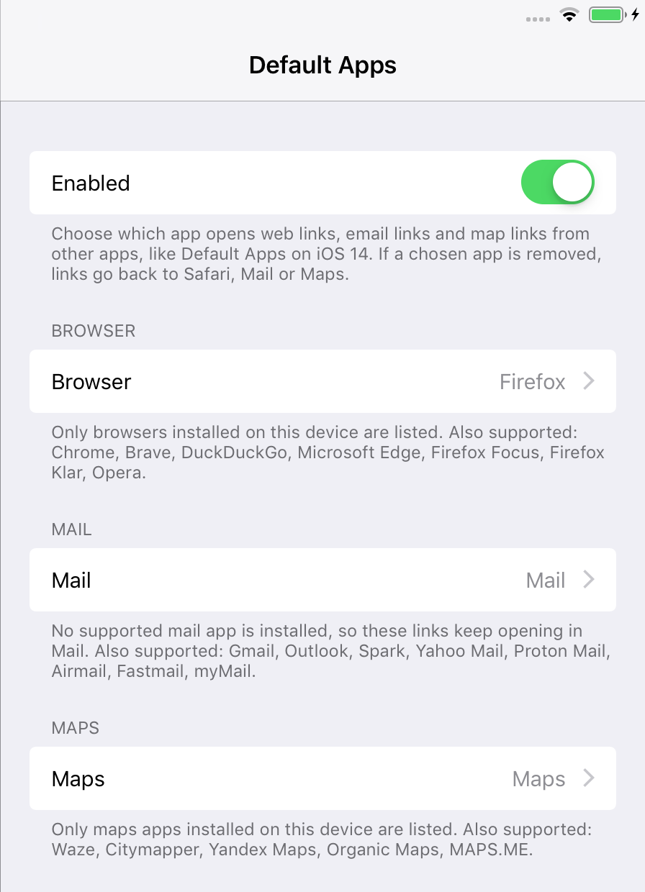
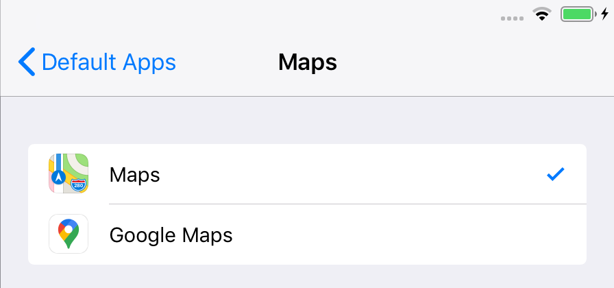
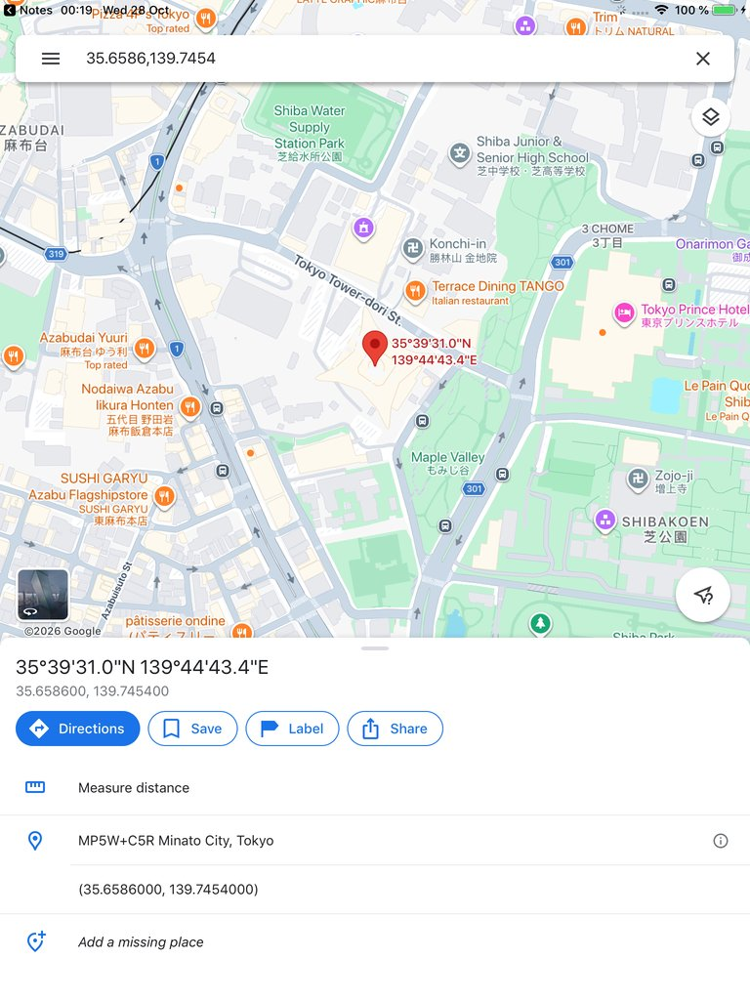
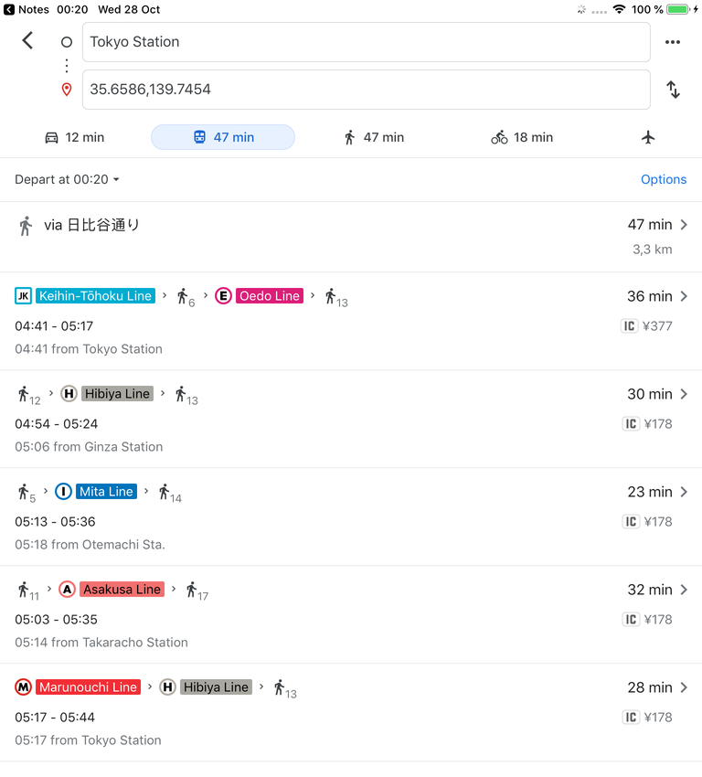
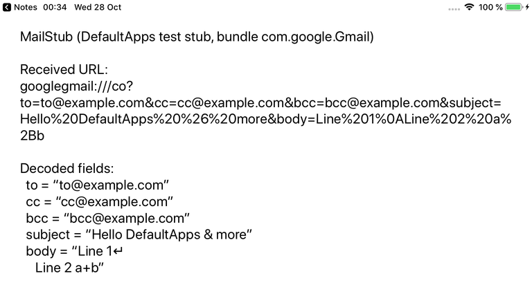

<p align="center"></p>

<h1 align="center">DefaultApps (iOS 12)</h1>

**Choose your default browser, mail app and maps app on iOS 12, like Default Apps on iOS 14.**

On iOS 12, web links always open in Safari, email links in Mail and map links in Maps. DefaultApps lets you pick other apps for all three in Settings. Links that other apps open (Notes, Messages, Mail, Firefox and so on) then go to the apps you chose.

This is an unofficial jailbreak tweak. It is not affiliated with or endorsed by Apple.

## Screenshots

Settings > Default Apps:



Each list shows the Apple app and the supported apps that are installed, with their icons:



An Apple Maps link tapped in Notes, opened in Google Maps at the same spot, and an Apple Maps transit route opened in Google Maps:

| Place | Route |
| --- | --- |
|  |  |

What a mail app receives for `mailto:to@example.com?cc=...&bcc=...&subject=Hello%20DefaultApps%20%26%20more&body=Line%201%0ALine%202%20a%2Bb` (shown by a small test app that registers the Gmail URL scheme):



## Features

- **Browser**: http and https links that would open in Safari open in the browser you pick.
- **Mail**: `mailto:` links open a new message in the mail app you pick, with To, Cc, Bcc, Subject and Body filled in. This includes email addresses and mail links tapped in Notes, Messages and other text, which iOS 12 would otherwise show as a Mail sheet inside the app.
- **Maps**: Apple Maps links (`maps:`, `map:` and `maps.apple.com`) open in the maps app you pick, at the same place, search or route.
- Each list shows the Apple app (Safari, Mail or Maps), which leaves that kind of link unchanged, and the supported apps that are installed, each with its icon.
- If a chosen app is removed, or a link cannot be expressed in its format, the link opens in the Apple app as before.
- Safari, Mail and Maps still open normally from their icons. "Open in Safari" inside another browser still works, and a mail or maps app that asks for the Apple app gets the Apple app.
- On/off switch. Changes apply right away, no respring needed.

## Supported apps

### Browsers

| App | URL format sent |
| --- | --- |
| Firefox | `firefox://open-url?url=<encoded URL>` |
| Chrome | `googlechrome://...` (http), `googlechromes://...` (https) |
| Brave | `brave://open-url?url=<encoded URL>` |
| DuckDuckGo | `ddgQuickLink://<URL>` |
| Firefox Focus / Klar | `firefox-focus://open-url?url=...` / `firefox-klar://open-url?url=...` |
| Microsoft Edge | `microsoft-edge-http://...`, `microsoft-edge-https://...` |
| Opera | `touch-http://...`, `touch-https://...` |

### Mail apps

Recipients, subject and body come from the `mailto:` link (RFC 6068). Every value is percent-encoded (only letters, digits, `-._~` and, in address lists, `@` and `,` stay as they are), so `&`, `=`, `+`, `#`, line breaks and non-ASCII text arrive unchanged.

| App | Bundle id | URL format sent |
| --- | --- | --- |
| Gmail | `com.google.Gmail` | `googlegmail:///co?to=&cc=&bcc=&subject=&body=` |
| Outlook | `com.microsoft.Office.Outlook` | `ms-outlook://emails/new?to=&cc=&bcc=&subject=&body=` |
| Spark | `com.readdle.smartemail` | `readdle-spark://compose?recipient=&cc=&bcc=&subject=&textbody=` |
| Yahoo Mail | `com.yahoo.Aerogram` | `ymail://mail/any/compose?to=&cc=&subject=&body=` (no Bcc field) |
| Proton Mail | `ch.protonmail.protonmail` | `protonmail://mailto:<to>?cc=&bcc=&subject=&body=` |
| Airmail | `it.bloop.airmail2` | `airmail://compose?to=&cc=&bcc=&subject=&plainBody=` |
| Fastmail | `com.fastmail.FastMail` | `fastmail://mail/compose?to=&cc=&bcc=&subject=&body=` |
| myMail | `com.my.mail` | `mymail-mailto://?to=&cc=&bcc=&subject=&body=` |

The formats are the ones Firefox for iOS uses for the same apps. Yahoo Mail has no Bcc field, so a link with Bcc recipients opens in Apple Mail instead of losing them.

### Maps apps

These Apple Maps parameters are understood: `q`, `address`, `ll`, `near`, `sll`, `z`, `t`, `saddr`, `daddr`, `dirflg`, and the newer `maps.apple.com/place?coordinate=&name=`, `/search?query=&center=` and `/directions?source=&destination=&mode=`.

| App | Bundle id | Place | Search | Route |
| --- | --- | --- | --- | --- |
| Google Maps | `com.google.Maps` | `comgooglemaps://?q=<lat,lng>&center=&zoom=` | `comgooglemaps://?q=&center=&zoom=&views=` | `comgooglemaps://?saddr=&daddr=&directionsmode=` |
| Waze | `com.waze.iphone` | `waze://?ll=<lat,lng>` | `waze://?q=&ll=` | `waze://?ll=` or `?q=` + `&navigate=yes` (from your location only) |
| Citymapper | `azdev.citymapper` | `citymapper://directions?endcoord=&endname=` | not supported | `citymapper://directions?startcoord=&endcoord=` (coordinates only) |
| Yandex Maps | `ru.yandex.traffic` | `yandexmaps://maps.yandex.ru/?pt=<lng,lat>&ll=&z=` | `...?text=&ll=&z=` | `...?rtext=<lat,lng>~<lat,lng>&rtt=auto/mt/pd` |
| Organic Maps | `app.organicmaps` | `om://map?ll=&n=` | `om://search?query=&cll=` | `om://route?sll=&saddr=&dll=&daddr=&type=` (coordinates only) |
| MAPS.ME | `com.mapswithme.full` | `mapsme://map?ll=&n=` | `mapsme://search?query=&cll=` | `mapsme://route?...` (coordinates only) |

Travel modes map as: driving / walking / transit / cycling to Google's `driving` / `walking` / `transit` / `bicycling`, Yandex `auto` / `pd` / `mt`, Organic Maps `vehicle` / `pedestrian` / `transit` / `bicycle`. A link that cannot be expressed for the chosen app (for example a Citymapper route to a street address, or an Apple-only place id) opens in Apple Maps.

Sources: the Google Maps URL scheme and Waze deep link pages on developers.google.com, Citymapper's "Launch Citymapper for Directions", Yandex's "Launching Yandex Maps" docs, Organic Maps' `mwm_url.cpp`, Firefox for iOS `MailProviders.swift`, and Apple's Map Links reference. Bundle ids were checked with the App Store lookup API. An app is only offered when its installed copy declares the URL scheme above.

## Compatibility

- Tested on an iPad mini 2 with iOS 12.5.8, jailbroken with checkra1n + odysseyra1n (libhooker).
- Expected to work on iOS 12.x. It should work on iPhone too, but it has only been tested on iPad.
- The apps must be installed and still run on iOS 12.

## Install

Add the **iOS Legacy** source to your package manager, then search for DefaultApps:

```
https://itsallexb.github.io/ios-legacy/
```

One tap on your device: [Add to Sileo](https://itsallexb.github.io/ios-legacy/add/sileo.html) · [Add to Zebra](https://itsallexb.github.io/ios-legacy/add/zebra.html) · [Add to Cydia](https://itsallexb.github.io/ios-legacy/add/cydia.html)

Or download the `.deb` from [Releases](https://github.com/itsAllexB/DefaultApps-iOS12/releases/latest) and install it with Filza or `dpkg -i`, then respring.

Requires `mobilesubstrate` (Substrate, Substitute or libhooker) and PreferenceLoader. Your package manager installs them automatically.

On a fresh install, Browser, Mail and Maps start on Safari, Mail and Maps, so nothing changes until you pick another app.

## Settings

Open **Settings > Default Apps**:

- **Enabled**: turns the tweak on or off.
- **Browser**, **Mail**, **Maps**: the app for each kind of link. The note under each list names the other supported apps, which appear once installed.

## Build from source

You need [Theos](https://theos.dev/docs/installation) and an iOS SDK (the Makefile uses the iOS 14.5 SDK and targets iOS 12.0, arm64).

```sh
git clone https://github.com/itsAllexB/DefaultApps-iOS12.git
cd DefaultApps-iOS12
make package FINALPACKAGE=1
```

The package is written to `packages/`. To install it on a device over SSH, set `THEOS_DEVICE_IP` and run `make install`.

The URL translation has unit tests that run on a Mac: `tests/run.sh`.

### How it works

- **SpringBoard** (`Tweak.x`): when an app opens a URL, LaunchServices picks the target app in the calling process and SpringBoard receives the request in `-[SBMainWorkspace systemService:handleOpenApplicationRequest:withCompletion:]`. (LaunchServices has already turned `https://maps.apple.com/?...` into `maps:...` by then.) DefaultApps rewrites requests for Safari (http/https), Mail (`mailto:`) and Maps (Apple Maps links) into the chosen app's URL and bundle id. The supported apps are listed in [`DAApps.h`](DAApps.h) and the URL formats are built in [`DAURL.m`](DAURL.m).
- **Inside apps** (`UITweak.x`, loaded into UIKit apps): tapping an email address or `mailto:` link in a text view is handled by DataDetectorsUI's `DDSendMailAction`, which shows Apple's compose sheet inside the app instead of opening a URL. When a mail app is chosen, DefaultApps makes that action open its `mailto:` URL instead, which SpringBoard then sends to the chosen app.

## Limitations

- Apps that show Apple's mail compose sheet themselves (a "Share by Mail" or "Send feedback" button that uses `MFMailComposeViewController`) still use Apple Mail. iOS 14 behaves the same way.
- Apple Maps links that only carry an Apple place id (`auid`, `place-id`) or an encoded map item open in Apple Maps. Apps that open Maps through `MKMapItem` may use such links.
- Mail and maps links are only taken over while Apple Mail and Apple Maps are installed (LaunchServices must hand the link to them first). This case has not been tested with the Apple apps deleted.
- Waze can only start a route from your current location, and Citymapper and Organic Maps need coordinates for routes; other routes open in Apple Maps.
- Google Maps shows a pin at the exact coordinates of a labelled place, but its URL scheme has no way to show the label.

## Credits and license

Made by [itsAllexB](https://github.com/itsAllexB).

DefaultApps is free software under the GNU General Public License v3.0 or later. See [LICENSE](LICENSE).

Safari, Mail and Maps are trademarks of Apple Inc.; other app names are trademarks of their owners. This project is not affiliated with Apple or with any app vendor.
